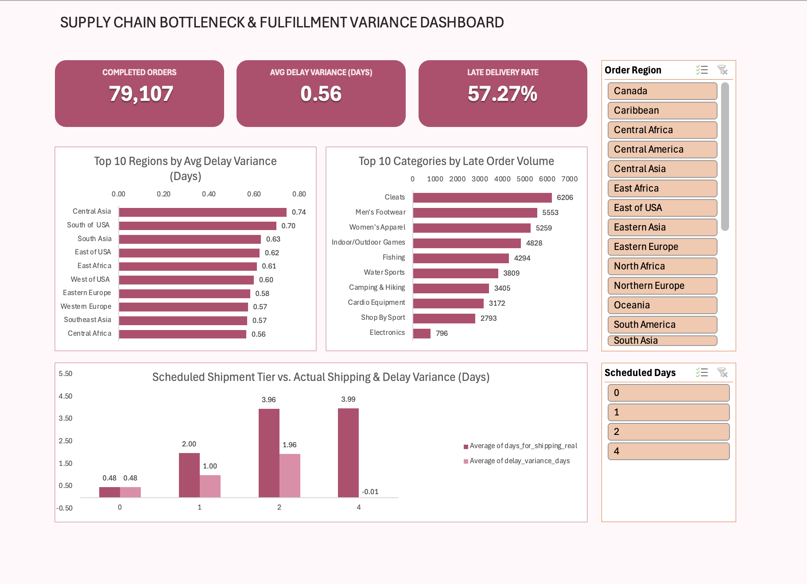

# Supply Chain Bottleneck & Fulfillment Variance Dashboard

Interactive Excel BI dashboard & SLA variance analysis across **79,107** supply chain orders identifying 2-day shipping bottlenecks, regional variance drivers, and high-risk product categories[cite: 11, 12].

---

## Executive Summary & Key Findings

* **Baseline Fulfillment Performance:** Across **79,107** completed orders, the network experiences a **57.27%** late delivery rate and an average fulfillment delay variance of **+0.56 days**[cite: 11].
* **Primary Bottleneck (2-Day SLA Mismatch):** Two-day scheduled shipments (`Scheduled Days = 2`) average **3.96 days** in actual transit—creating a **+1.96-day** delay spike—whereas 4-day scheduled shipments average **3.99 days** (**-0.01-day** variance), demonstrating that current transit capacity aligns with a 4-day SLA rather than 2-day promises[cite: 11].
* **Regional Variance Hotspots:** **Central Asia** (`+0.74 days`) and **South of USA** (`+0.70 days`) exhibit the highest average shipping delay variance across global territories[cite: 11].
* **Category Volume Drivers:** **Cleats** (`6,206` late orders) and **Men's Footwear** (`5,553` late orders) account for the largest total volume of delayed deliveries[cite: 11].

---

## Technical Architecture & Features

* **Decoupled Pivot Engine (`Pivot_Engine`):** Four independent PivotTables isolated across separate column blocks (`A`, `E`, `I`) to prevent vertical layout collisions during dynamic cross-filtering[cite: 7].
* **Interactive Cross-Filtering:** Dual slicers (**Order Region** and **Scheduled Days**) wired via `Report Connections` to recalculate all three KPI cards and all three visualizations simultaneously[cite: 11].
* **Visual Hierarchy:** Single-screen executive layout featuring high-contrast KPI cards (`#B84A6E`), Top 10 horizontal bottleneck rankings, and a clustered column SLA variance comparison[cite: 11].

---

## Actionable Recommendations

1. **Recalibrate 2-Day Shipping Promises:** Adjust customer-facing delivery estimates on standard ground tiers from 2 days to 4 days (or restrict 2-day promises to expedited air carriers) to eliminate the **+1.96-day** expectation gap[cite: 11].
2. **Target High-Volume Footwear & Apparel Fulfillment:** Prioritize regional warehouse inventory pre-positioning for **Cleats**, **Men's Footwear**, and **Women's Apparel** in high-variance territories such as **Central Asia** and **South of USA**[cite: 11].
